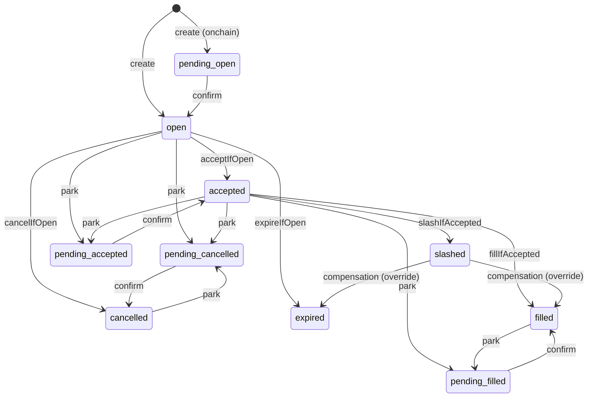

# Architecture: Intent State Machine (issue #406)

Every change to `intents.state` follows one declarative table,
`TRANSITION_TABLE` in [`src/intents/state-machine.ts`](../../src/intents/state-machine.ts).
It is enforced twice: in TypeScript before every write, and in Postgres by a
trigger on every `UPDATE`.

## States and edges



| Kind | Meaning | Needs override |
|------|---------|----------------|
| `lifecycle` | Business transitions (accept, fill, cancel, expire, slash) | no |
| `park` | Off-chain write committed, chain write in flight (issue #385) | no |
| `confirm` | Chain confirmed the in-flight write | no |
| `compensation` | Slashing saga rolled a slash back (issue #397) | **yes** |

`filled`, `cancelled`, `expired` and `slashed` are terminal for the lifecycle.
Parks out of `filled`/`cancelled` only mark that the chain has not confirmed
the decision yet; they do not reopen the intent. `TRANSITIONS` and
`canTransition()` expose the lifecycle-only view that the TLA+ model in
`formal/` mirrors.

## Write path

1. **Plan** — `transition(intent, to, ctx)` is pure. It finds the rule,
   rejects missing edges (and compensations without `ctx.override`) with
   `IllegalTransitionError`, and returns a plan with the audit entry.
2. **Persist** — the repository applies the change with a conditional write
   on the expected `from` state (`acceptIfOpen`, …, or the generic
   `transitionIf` for park/confirm/compensation). Zero rows means another
   writer won the race; nothing else happens.
3. **Side effects** — only when the write won, `IntentsService` records the
   funnel metric and writes the audit entry from the plan (actor, reason,
   metadata plus `fromState`). Callers pass `{ actor, reason, metadata }`
   instead of writing audit entries themselves.

`IntentsService.update()` with a `state` patch still bypasses all of this and
is reserved for test setup (it logs a warning).

## Database enforcement

Migration `20261020000000_intent_state_transition_trigger` adds:

- `intent_state_transitions(from_state, to_state, kind)` — every
  non-compensation edge, generated from `TRANSITION_TABLE` by
  `renderAllowedPairsSql()`.
- `intents_enforce_state_transition` — a `BEFORE UPDATE OF state` trigger
  that raises `check_violation` (`illegal intent state transition a -> b`)
  for any pair not in that table.

Compensations, and the dual-write mirror's catch-up writes (which replicate
decisions the primary store already validated), run in a transaction that
first sets the transaction-local override:

```sql
SELECT set_config('vortex.intent_state_override', 'on', true);
```

The flag ends with the transaction, so it cannot leak across a pooled
connection. Inserts are not checked; creation is not a transition.

### Keeping TS and SQL in sync

`npm run check:state-machine` compares the seed in the migration with
`renderAllowedPairsSql()`; `src/intents/state-machine-sql.spec.ts` does the
same inside `npm test`. To add an edge: add the rule, then ship a **new**
migration that inserts the pair (applied migrations never change) and point
the check script at it.

### Tests

- `state-machine.spec.ts` — all 100 `(from, to)` pairs against a hand-written
  expectation, plus `transition()` behaviour.
- `state-machine-sql.spec.ts` — the same 100 pairs as real `UPDATE`s against
  Postgres (set `TEST_DATABASE_URL` to a migrated database), override
  behaviour, and override scoping.
- `intents.service.state-machine.spec.ts` — the service writes exactly one
  audit entry per persisted transition and none on a lost race.

### Rollback

`down.sql` drops the trigger, its function and the table. No intent data
changes in either direction.
